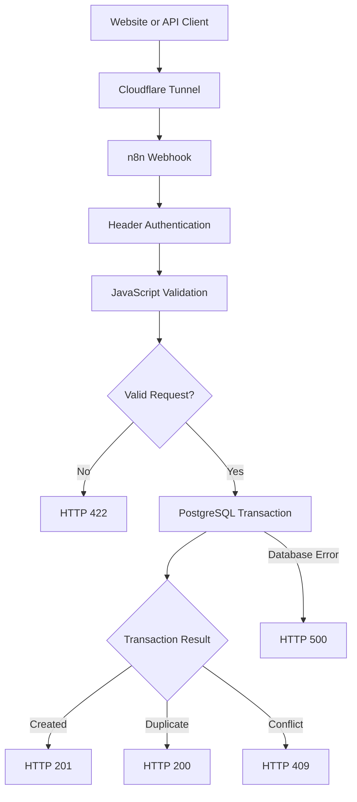
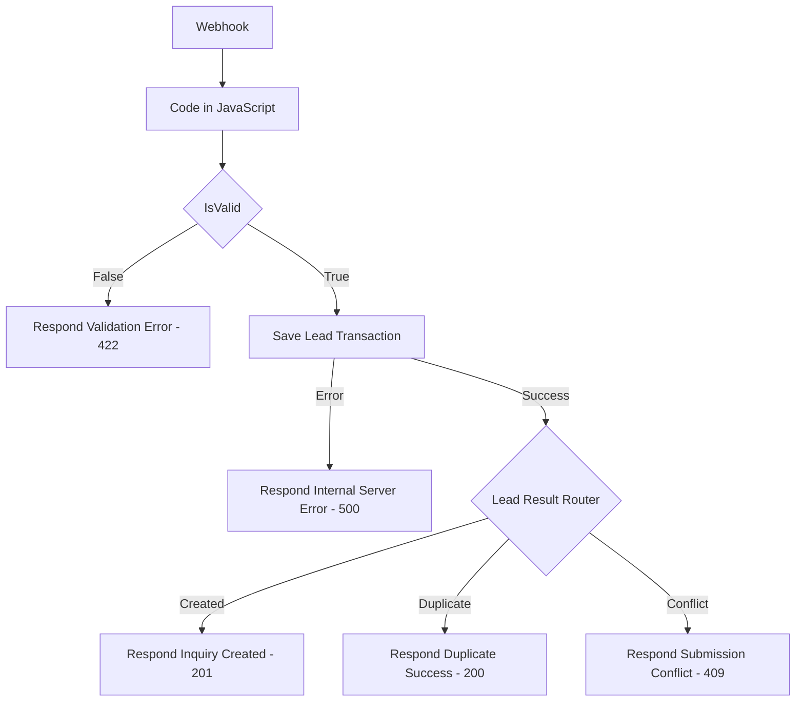
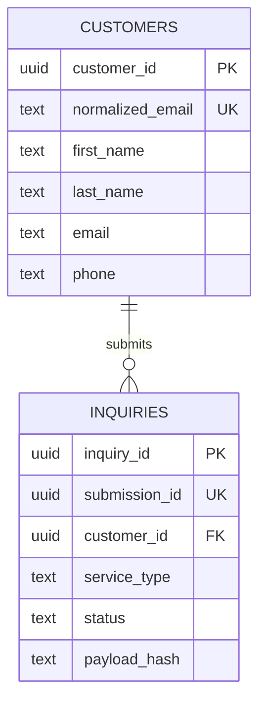

# Northstar Home Services
## System Architecture

**Project ID:** NHS-001
**Version:** 1.0
**Environment:** Development / Testing

---

## 1. Architecture Overview

The Northstar Lead Intake API uses n8n for
request validation and workflow orchestration,
and PostgreSQL for reliable data persistence.

The development environment runs in Docker
containers and exposes the n8n API endpoint
through a Cloudflare Tunnel.

### High-Level Architecture

## 2. Infrastructure Components

### Docker Compose

The development environment contains three
main services:

- n8n: Workflow execution and API handling.
- PostgreSQL: Customer and inquiry storage.
- cloudflared: HTTPS tunnel to the n8n service.

n8n communicates with PostgreSQL over the
Docker Compose internal network.

PostgreSQL connection configuration:

- Host: postgres
- Port: 5432
- Database: northstar_crm
- User: northstar
- SSL: Disabled for the internal Docker connection

Credentials and secrets must remain outside
source-controlled documentation.

### Cloudflare Tunnel

The Cloudflare Tunnel provides an HTTPS entry
point without directly publishing the
PostgreSQL database.

The public hostname forwards requests to n8n.

## 3. n8n Workflow

Workflow name:

NHS-001 | Lead Intake API

The active workflow consists of ten nodes.

### Request Processing

1. Webhook
   Receives authenticated POST requests.

2. Code in JavaScript
   Validates and normalizes request fields.

3. IsValid
   Routes valid and invalid requests.

4. Save Lead Transaction
   Calls the PostgreSQL function
   northstar_save_lead(jsonb).

5. Lead Result Router
   Routes successful database results.

### HTTP Responses

6. Respond - Validation Error
   HTTP 422

7. Respond - Inquiry Created
   HTTP 201

8. Respond - Duplicate Success
   HTTP 200

9. Respond - Submission Conflict
   HTTP 409

10. Respond - Internal Server Error
    HTTP 500

### Workflow Diagram

## 4. Database Schema

Two primary business tables are used.

### customers

Stores customer identity and contact details.

Important columns:

- customer_id: UUID primary key
- first_name: Customer first name
- last_name: Customer last name
- email: Trimmed original email
- normalized_email: Lowercase email, UNIQUE
- phone: Optional normalized phone number
- created_at: Creation timestamp
- updated_at: Update timestamp

### inquiries

Stores individual service requests.

Important columns:

- inquiry_id: UUID primary key
- submission_id: Unique external submission UUID
- customer_id: Foreign key to customers
- first_name: Submitted first name
- last_name: Submitted last name
- email: Submitted email
- phone: Optional submitted phone
- service_type: Requested service
- zip_code: Five-digit US ZIP code
- message: Inquiry message
- assigned_team: Optional assignment
- status: Inquiry processing status
- submitted_at: Client submission timestamp
- created_at: Database creation timestamp
- payload_hash: SHA-256 hash of normalized payload

### Relationship

One customer may have multiple inquiries.

## 5. Atomic Database Processing

The PostgreSQL function:

public.northstar_save_lead(jsonb)

performs customer resolution and inquiry
creation within a single database transaction.

### Processing Sequence

1. Parse the validated JSON payload.
2. Compute the SHA-256 payload hash.
3. Acquire a transaction-scoped advisory lock
   based on submission_id.
4. Check for an existing submission.
5. If an existing hash matches, return duplicate.
6. If hashes differ, return conflict.
7. Resolve the customer using normalized_email.
8. Create the customer if necessary.
9. Insert the inquiry linked to customer_id.
10. Return the created identifiers.

### Atomicity

If inquiry creation fails because of a
database constraint, the transaction fails
and the preceding customer insertion is
rolled back.

This behavior was verified with an invalid
service_type rollback test.

## 6. Idempotency and Concurrency

### Submission Idempotency

Each distinct lead submission has a unique
submission_id.

The normalized request payload is hashed using
SHA-256.

The system distinguishes:

- New submission
- Repeated submission with matching content
- Reused submission ID with different content

### Concurrency Protection

The function uses:

pg_advisory_xact_lock(...)

to serialize requests sharing a submission ID.

Database UNIQUE constraints provide additional
protection against duplicate records.

A 20-request concurrent load test produced:

- Created: 1
- Duplicate: 19
- Other errors: 0

A separate database verification confirmed
that exactly one customer and inquiry existed
for the tested submission.

These tests demonstrate the observed behavior
under the tested workload, not an absolute
guarantee for every production scenario.

## 7. Security Design

### Authentication

The webhook uses the X-API-Key header with
n8n Header Auth credentials.

### SQL Injection Protection

Database calls use parameterized SQL queries.

### Secrets

Database passwords and API keys are stored
in environment variables or n8n credentials.

They must not be committed to source control.

### Error Handling

Unexpected database failures are routed to a
generic HTTP 500 response.

Internal database errors are not exposed
in public response bodies.

### Network Access

PostgreSQL is accessed through the internal
Docker network rather than the public tunnel.

## 8. Operational Considerations

Before production deployment, complete:

- Production credential and secret review.
- Production webhook configuration.
- Rate limiting and abuse prevention.
- Monitoring and alerting.
- Backup and recovery verification.
- Data retention and privacy requirements.
- Logging and audit review.
- Additional concurrency and failure testing.
- Resolution or documentation of the
  HTTP 401 versus 403 authentication difference.

## 9. Project Scope

This project is a fictional technical portfolio
demonstration.

It implements lead intake, validation,
customer resolution, persistence, idempotency,
and structured API responses.

It does not yet implement a complete CRM
user interface, team assignment workflow,
customer notifications, or reporting dashboard.
