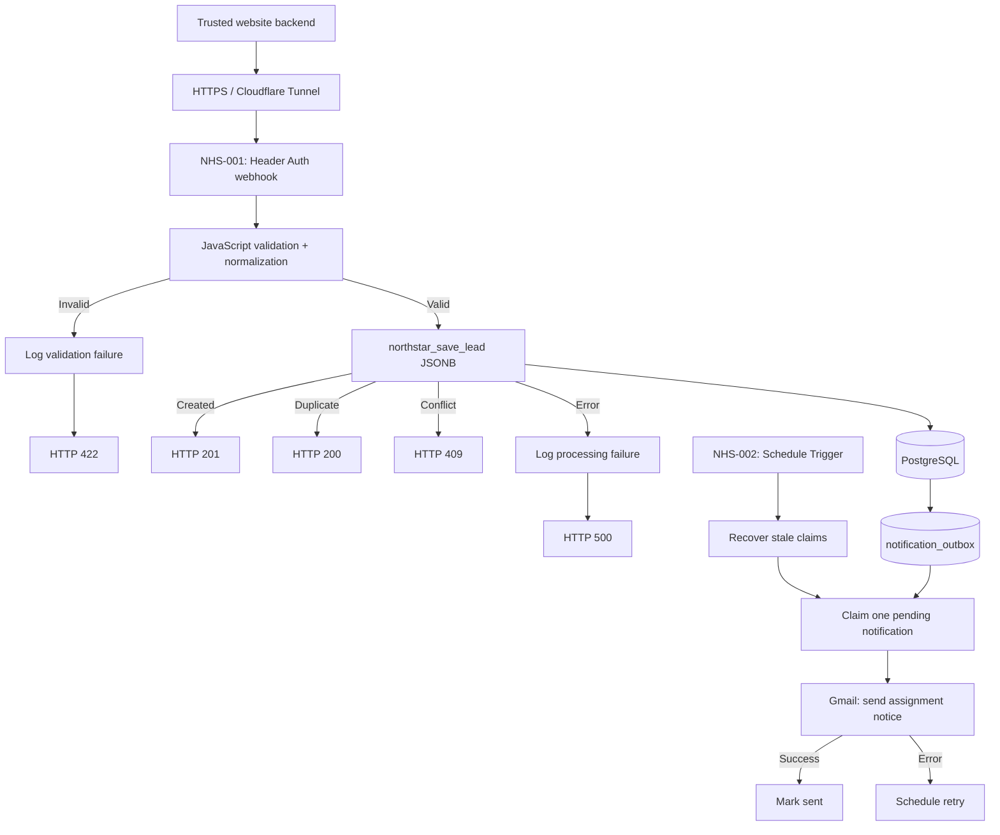

# Northstar — System Architecture

**Environment:** n8n 2.45.4, PostgreSQL 18, Docker Compose, Cloudflare Tunnel · **Status:** tested development implementation

## Flow

The development environment uses three Compose services: `n8n`, `postgres`, `cloudflared`. The database is reached on the internal Docker network (`postgres:5432`); its host port is not published by the inspected configuration. PostgreSQL persistence is backed by a Docker volume. Hosted HTTPS addresses and credentials are deployment-specific.

## Two n8n workflows

**NHS-001 — Lead Intake API:** webhook → JavaScript validation → `IsValid` → parameterized PostgreSQL function → result routing to 201, 200, 409; invalid inputs and processing errors are logged through PostgreSQL nodes before sending 422/500. Header Auth rejects requests ahead of this route (observed 403).

**NHS-002 — Email Notification Dispatcher:** scheduled trigger → `northstar_recover_stale_notifications()` → claim one queued item using `FOR UPDATE SKIP LOCKED` → Gmail send → parameterized state update for sent/failed. The failed path uses backoff based on `attempt_count`; a stale processing claim can be recovered. The current `.first()` expressions presume **one claimed notification per run**. Gmail delivery is at-least-once in failure windows; a crash between Gmail acceptance and DB confirmation can create a duplicate e-mail, even though each inquiry is queued once.

## Database

| Table | Purpose | Key protections |
|---|---|---|
| `customers` | Stable customer profile | UUID PK, unique `normalized_email` |
| `inquiries` | Individual service request and submitted data | UUID PK, unique `submission_id`, FK `customer_id`, validation constraints |
| `service_routing` | Active service → coordinator mapping | `service_type` PK |
| `audit_events` | Processing events and restricted metadata | Event ID and timestamp; indexes for lookup |
| `notification_outbox` | Durable e-mail dispatch queue | Inquiry FK, send status, attempt counter, retry/claim timestamps |

`inquiries` includes `status` (initially `new`), `assigned_team`, `needs_manual_review`, `has_customer_discrepancy`, `payload_hash`, `submitted_at`, and `created_at`. Original submitted contact details are stored on each inquiry. A discrepancy does not overwrite the existing customer record.

### Atomic intake and idempotency

`public.northstar_save_lead(jsonb)` computes the hash of the normalized payload, takes a transaction-scoped advisory lock keyed to `submission_id`, and resolves new/duplicate/conflicting requests. For a new request it resolves the customer by normalized email, inserts the inquiry, assigns a team (or manual review), and writes significant audit events. A failed transaction rolls back related business inserts; a successful inquiry insert triggers outbox enqueuing within the database transaction.

The outbox trigger prevents a committed lead from being silently skipped because the mail service was unavailable, but does **not** promise exactly-once Gmail delivery.

### Audit events

Recorded events include request acceptance, customer created/matched, inquiry creation, duplicate detection, assignment completed/failed, validation failure, and processing failure. Event rows contain identifiers, status, timestamps and limited structured metadata. The intent is to avoid storing API keys, passwords, or unnecessary personal details.

## Security and configuration

- API authentication: n8n `X-API-Key` Header Auth; trusted-backend use only.
- SQL uses query parameters (`$1`, `$2`) in inspected PostgreSQL nodes. Text resembling SQL was verified to persist as plain data.
- n8n database credential uses restricted `northstar_app` (not the owner/superuser). Migrations `020`–`021` configure grants and revoke `PUBLIC EXECUTE` from the three application functions.
- Role `northstar` is an administrative database owner and should **not** be used by n8n application nodes.
- Workflow JSONs are sanitized of credential references and pinned execution data. Imported copies require credential reassignment; Gmail recipient is a placeholder.
- Internal failures return a generic error response, without exposing SQL internals.

The inspected PostgreSQL connection uses SSL disabled **inside the Compose network**; a public DB endpoint is not part of this architecture. Production network access, HTTPS termination, role hardening, secrets rotation, monitoring, privacy and retention requirements require separate review.

## Deployment and reproducibility

The 21 numbered migrations were applied in order to a fresh isolated PostgreSQL 18 test container, yielding five tables, three Northstar functions, one notification trigger, and a non-superuser `northstar_app` role. The temporary database was deleted after the test.

For another deployment: provision PostgreSQL 18 and the owner role, run migrations 001–021 in order, set an application password securely, import both n8n exports, attach Header Auth / PostgreSQL / Gmail OAuth credentials, replace the placeholder recipient, then test the endpoint and dispatcher. Do not publish the API secret or use the public client to hold it.

**Limitations:** no full CRM UI (out of scope); no demonstrated production monitoring, rate limiting, formal backup restore, or automated acceptance harness. HTTP code differences are tracked in the [API Contract](02-api-contract.md), and the acceptance matrix in the [Test Report](04-test-report.md).
