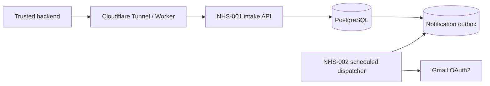

# Architecture

**NHS-001 (16 nodes):** database-backed API-key verification → JavaScript validation → `northstar_save_lead(jsonb)` → HTTP response. PostgreSQL handles customer matching, idempotency, routing and transactional persistence. Validation and processing failure branches record audit events when database access allows it.

**Database:** `customers`, `inquiries`, `service_routing`, `audit_events`, `notification_outbox`, `api_auth_keys`. The restricted `northstar_app` role has application-specific privileges; API-key hashes are checked through a `SECURITY DEFINER` function without granting the app direct access to the key table.

**NHS-002 (6 nodes):** scheduled recovery of stale claims → claim pending outbox item with `FOR UPDATE SKIP LOCKED` → Gmail send → mark sent or schedule retry. Notification delivery is **at least once**: a crash after Gmail accepts a message but before the database is updated can cause a repeat email.

The Docker setup separates n8n, PostgreSQL and Cloudflare Tunnel; it does not publish the database port. Production concerns such as tested backup restores, independent monitoring, execution-data retention and data-deletion policy require separate design.

See [deployment instructions](../deployment/README.md) for environment variables, credentials and Worker routing.

## Failure and security boundaries

The Cloudflare Worker enforces a 32 KiB request limit. An active Cloudflare rate limiting rule protects the intake URI path; its configured threshold is not a substitute for load or denial-of-service testing.

The application database role is non-superuser but retains direct write permissions needed by existing SECURITY INVOKER functions and dispatcher SQL. Compromise of application database credentials can therefore affect business records; a function-only write model has not been implemented.

Failed n8n production-execution saving is disabled to reduce retention of sensitive request data. Execution records may contain request payloads or sensitive headers, and must be access-controlled and pruned. This execution history and the PostgreSQL audit table are not independent of database availability: a total database outage can prevent both from persisting diagnostics. Safe HTTP error handling does not establish durable outage logging.
